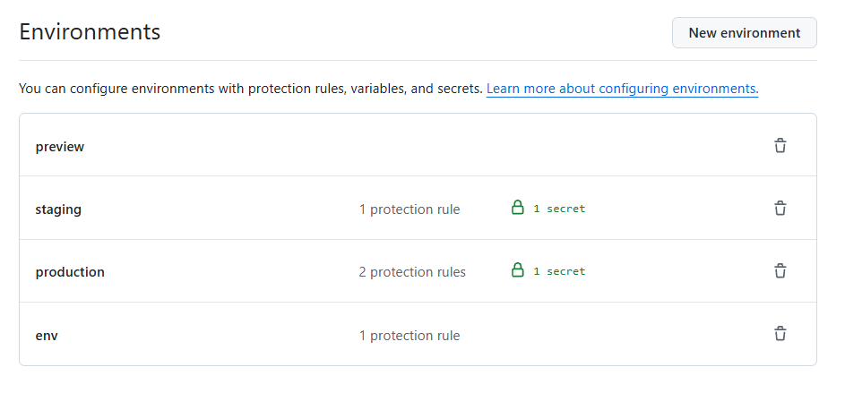
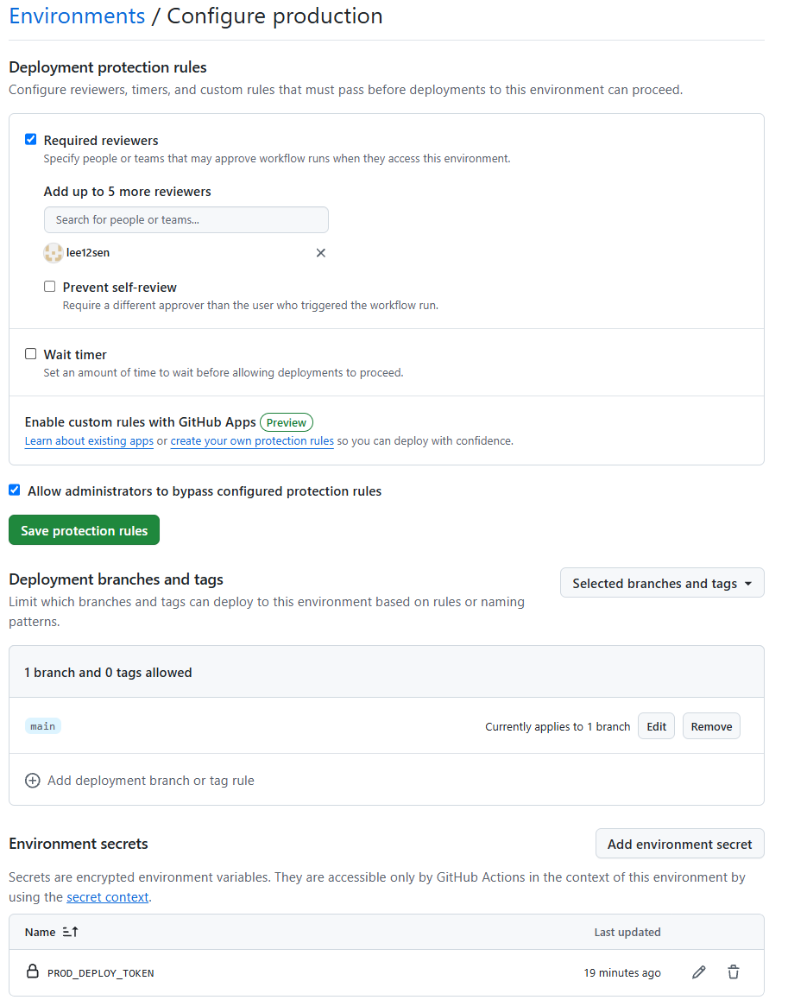
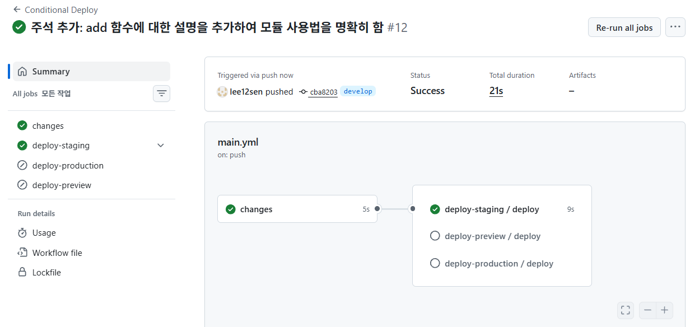
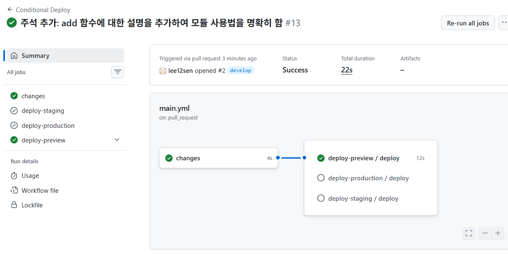
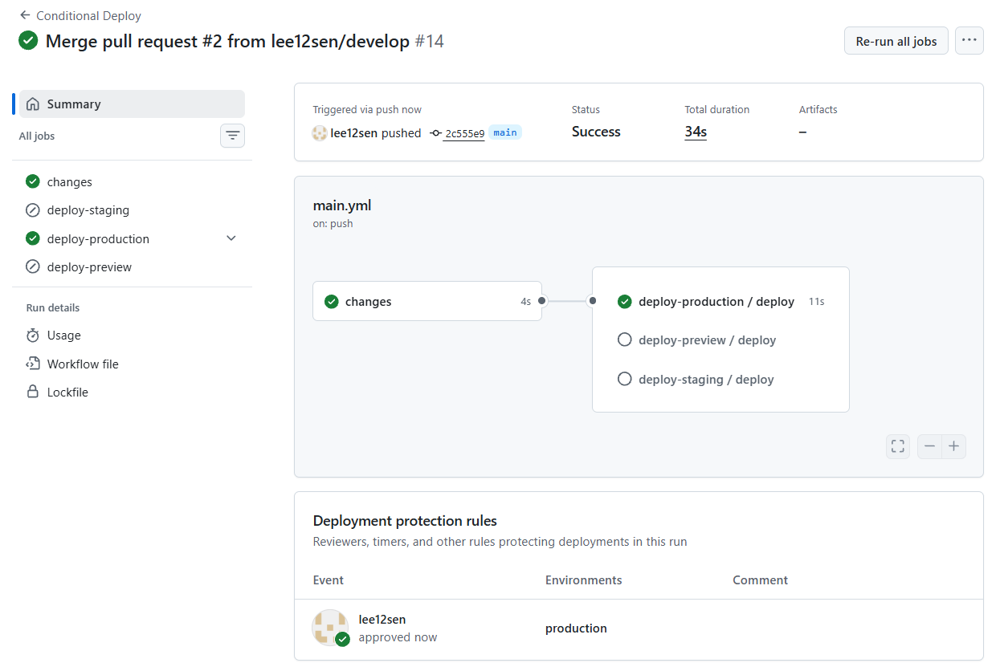
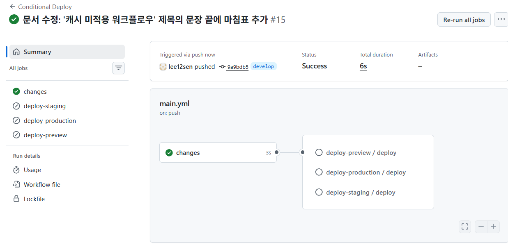

# 과제 4: 조건부 배포 및 환경 분리 리포트

## 1. 과제 개요

브랜치 전략에 따라 배포 대상 환경을 분기하고, 파일 변경 감지를 통해 애플리케이션 코드가 변경된 경우에만 배포 Job이 실행되도록 GitHub Actions 워크플로우를 구성했다. 또한 GitHub Environment를 사용해 환경별 보호 규칙을 적용할 수 있도록 배포 Job에 `environment`를 지정했다.

| 이벤트 | 대상 브랜치 | 배포 환경 |
|---|---|---|
| `push` | `main` | Production |
| `push` | `develop` | Staging |
| `pull_request` | `main`, `develop` 대상 PR | Preview (Ephemeral) |

## 2. 워크플로우 구성

| 파일 | 역할 |
|---|---|
| [`main.yml`](.github/workflows/main.yml) | 변경 감지 후 브랜치/이벤트에 따라 배포 Job 분기 |
| [`reusable-deploy.yml`](.github/workflows/reusable-deploy.yml) | 환경 이름을 입력받아 테스트 및 배포를 수행하는 재사용 워크플로우 |
| [`deploy-production.yml`](.github/workflows/deploy-production.yml) | Production 수동 배포 (`workflow_dispatch`) |
| [`deploy-staging.yml`](.github/workflows/deploy-staging.yml) | Staging 수동 배포 (`workflow_dispatch`) |

전체 실행 흐름은 다음과 같다.

```text
push / pull_request
        │
        ▼
   [changes] ── dorny/paths-filter로 애플리케이션 코드 변경 여부 확인
        │
        ├─ application == true && push && main     → deploy-production → Production
        ├─ application == true && push && develop  → deploy-staging    → Staging
        └─ application == true && pull_request     → deploy-preview    → Preview
```

## 3. 브랜치별 배포 전략

### 트리거 설정

```yaml
on:
  push:
    branches:
      - main
      - develop
  pull_request:
    branches:
      - main
      - develop
```

`main`, `develop` 브랜치에 대한 push와, 두 브랜치를 대상으로 하는 PR에서 워크플로우가 실행된다.

### `if` 조건문을 이용한 분기

```yaml
deploy-production:
  needs: changes
  if: >
    needs.changes.outputs.application == 'true' &&
    github.event_name == 'push' &&
    github.ref == 'refs/heads/main'
  uses: ./.github/workflows/reusable-deploy.yml
  with:
    environment: production
    node-version: "20"
  secrets:
    deploy_token: ${{ secrets.PROD_DEPLOY_TOKEN }}
```

- `github.event_name == 'push'`: PR 이벤트에서는 Production/Staging 배포가 실행되지 않도록 제한
- `github.ref == 'refs/heads/main'`: `main` 브랜치일 때만 Production 배포
- `deploy-staging`은 같은 구조로 `refs/heads/develop`일 때 `staging` 환경에 배포

PR 이벤트에서는 `github.ref`가 `refs/pull/<번호>/merge` 형태가 되므로, 이벤트 종류를 함께 검사해 PR이 Production/Staging 조건에 걸리지 않도록 했다.

### PR Preview 배포

```yaml
deploy-preview:
  needs: changes
  if: >
    needs.changes.outputs.application == 'true' &&
    github.event_name == 'pull_request'
  uses: ./.github/workflows/reusable-deploy.yml
  with:
    environment: preview
    node-version: "18"
    require-token: false
```

PR이 생성되거나 업데이트되면 `preview` 환경으로 임시 배포한다. Preview는 검토용 임시 환경이므로 배포 토큰을 요구하지 않도록 `require-token: false`를 전달했다. 포크 저장소에서 올라온 PR에는 시크릿이 전달되지 않기 때문에, 토큰이 필수라면 Preview 배포가 항상 실패하게 되는 문제도 함께 해결된다.

### 재사용 워크플로우 수정

세 환경이 하나의 [`reusable-deploy.yml`](.github/workflows/reusable-deploy.yml)을 공유하도록 다음과 같이 수정했다.

```yaml
on:
  workflow_call:
    inputs:
      environment:
        required: true
        type: string
      require-token:
        required: false
        type: boolean
        default: true
    secrets:
      deploy_token:
        required: false   # 기존 true → Preview 배포를 위해 false로 변경

jobs:
  deploy:
    runs-on: ubuntu-latest
    environment: ${{ inputs.environment }}   # GitHub Environment 연결
```

토큰 검증은 `require-token`이 `true`일 때만 수행되므로, Production/Staging은 기존처럼 토큰이 없으면 배포가 실패하고 Preview만 토큰 없이 배포된다.

```bash
if [ "${{ inputs.require-token }}" = "true" ] && [ -z "$DEPLOY_TOKEN" ]; then
  echo "DEPLOY_TOKEN is required" >&2
  exit 1
fi
```

그 외에 `actions/checkout@v3`를 `@v4`로 업데이트했다.

### 기존 개별 배포 워크플로우 정리

기존 `deploy-production.yml`, `deploy-staging.yml`은 각각 `main`, `develop` push에서 실행되어 `main.yml`과 함께 **같은 배포가 두 번 실행**되는 문제가 있었다. 두 파일의 트리거를 `workflow_dispatch`로 변경하여 자동 배포는 `main.yml`이 담당하고, 두 파일은 필요할 때 수동으로 재배포하는 용도로만 사용하도록 했다.

```diff
 on:
-  push:
-    branches: [main]
+  workflow_dispatch:
```

## 4. 파일 변경 감지

빌드 시간을 줄이기 위해 `dorny/paths-filter@v3`로 애플리케이션 코드 변경 여부를 먼저 확인하는 `changes` Job을 추가했다.

```yaml
changes:
  runs-on: ubuntu-latest
  outputs:
    application: ${{ steps.filter.outputs.application }}
  steps:
    - uses: actions/checkout@v4
    - name: Detect application changes
      id: filter
      uses: dorny/paths-filter@v3
      with:
        filters: |
          application:
            - 'frontend/**'
            - 'src/**'
            - 'app/**'
            - 'backend/**'
            - 'api/**'
            - 'server/**'
            - 'functions/**'
            - '**/*.js'
            - '**/*.jsx'
            - '**/*.ts'
            - '**/*.tsx'
            - 'package.json'
            - 'package-lock.json'
```

- 프론트엔드(`frontend/`, `src/`, `app/`)와 백엔드(`backend/`, `api/`, `server/`, `functions/`) 디렉터리를 모두 감시한다.
- 현재 저장소는 루트에 `index.js`가 있는 구조이므로 `**/*.js` 등 확장자 패턴도 포함했다.
- 의존성이 바뀌면 배포 결과가 달라질 수 있으므로 `package.json`, `package-lock.json`도 포함했다.

`changes` Job의 출력값 `application`을 모든 배포 Job이 `needs.changes.outputs.application == 'true'`로 검사한다. 따라서 `과제4.md` 같은 문서나 이미지 파일만 변경된 커밋에서는 `changes` Job만 실행되고 배포 Job은 **Skipped** 처리된다.

| 변경 파일 예시 | `application` | 배포 Job |
|---|---|---|
| `index.js` | `true` | 실행 |
| `package-lock.json` | `true` | 실행 |
| `과제4.md`, `image.png` | `false` | Skipped |
| `.github/workflows/*.yml` | `false` | Skipped |

## 5. 환경 보호 규칙

[`reusable-deploy.yml`](.github/workflows/reusable-deploy.yml)의 배포 Job에 `environment: ${{ inputs.environment }}`를 지정하여, 각 배포가 GitHub Environment(`production`, `staging`, `preview`)에 연결되도록 했다. 보호 규칙은 YAML이 아니라 저장소의 **Settings → Environments**에서 설정한다.

| Environment | 설정 | 효과 |
|---|---|---|
| `production` | Required reviewers 지정 | 배포 Job이 승인 대기 상태로 멈추고, Reviewer가 승인해야 실행됨 |
| `production` | Deployment branches: `main`만 허용 | `main` 외 브랜치에서는 Production 배포 불가 |
| `production` | Environment secret `PROD_DEPLOY_TOKEN` | Production 배포 Job에서만 토큰 접근 가능 |
| `staging` | Deployment branches: `develop`만 허용 | `develop` 외 브랜치에서는 Staging 배포 불가 |
| `staging` | Environment secret `STAGING_DEPLOY_TOKEN` | Staging 배포 Job에서만 토큰 접근 가능 |
| `preview` | 보호 규칙 없음 | PR마다 자유롭게 임시 배포 |

워크플로우의 `if` 조건과 Environment의 브랜치 제한이 함께 적용되므로, 워크플로우 파일이 잘못 수정되더라도 Environment 설정에 의해 허용되지 않은 브랜치에서는 Production 배포가 차단된다.

### 환경 설정 결과

**Settings → Environments 목록**



- `production`: 보호 규칙 2개(Required reviewers, Deployment branches) + secret 1개(`PROD_DEPLOY_TOKEN`)
- `staging`: 보호 규칙 1개(Deployment branches: `develop`) + secret 1개(`STAGING_DEPLOY_TOKEN`)
- `preview`: 보호 규칙 없음
- `env`: 이전 실습에서 생성된 환경으로, 이번 과제와는 관련 없음

**production 환경 상세 설정**



- **Required reviewers**: `lee12sen`을 Reviewer로 지정했다. 1인 저장소이므로 본인이 승인할 수 있도록 **Prevent self-review**는 해제했다.
- **Deployment branches and tags**: `Selected branches and tags`로 변경하고 `main` 브랜치 규칙만 추가했다.
- **Environment secrets**: `PROD_DEPLOY_TOKEN`을 production 환경 전용 secret으로 등록했다.

## 6. 실행 결과

| Run | 트리거 | 브랜치 | 실행된 배포 Job | Skipped Job | 소요 시간 | 결과 |
|---|---|---|---|---|---:|---|
| #12 | `push` | `develop` | `deploy-staging` | `deploy-production`, `deploy-preview` | 21초 | Success |
| #13 | `pull_request` (#2) | `develop` → `main` | `deploy-preview` | `deploy-staging`, `deploy-production` | 22초 | Success |
| #14 | `push` (PR #2 merge) | `main` | `deploy-production` (승인 후) | `deploy-staging`, `deploy-preview` | 34초 | Success |
| #15 | `push` (문서만 수정) | `develop` | 없음 | `deploy-staging`, `deploy-production`, `deploy-preview` | 6초 | Success |

#12~#14는 `index.js`에 주석을 추가한 커밋이므로 `changes` Job에서 `application == true`로 판단되어 배포 Job이 실행되었다. 반면 #15는 `.md` 문서만 수정한 커밋이므로 `application == false`가 되어 모든 배포 Job이 생략되었다.

### Run #12: `develop` push → Staging



`develop` 브랜치에 push하자 `changes` Job 이후 `deploy-staging / deploy`만 실행되고, `deploy-production`과 `deploy-preview`는 조건이 맞지 않아 Skipped 처리되었다.

### Run #13: PR 생성 → Preview



`develop` → `main` PR(#2)을 생성하자 `on: pull_request` 이벤트로 워크플로우가 실행되었다. `github.event_name == 'pull_request'` 조건에 따라 `deploy-preview / deploy`만 실행되었으며, 토큰 없이도 배포가 성공했다.

### Run #14: `main` merge → Production (Reviewer 승인)



PR #2를 `main`에 merge하자 push 이벤트로 `deploy-production / deploy`가 실행되었다. production 환경에 Required reviewers가 설정되어 있으므로 Job이 바로 실행되지 않고 승인 대기 상태가 되었으며, 하단의 **Deployment protection rules** 항목에서 `lee12sen`이 `production` 환경 배포를 **approved** 한 기록을 확인할 수 있다. 승인 이후 배포가 진행되어 성공했다. 승인 대기 시간이 포함되어 다른 실행보다 소요 시간(34초)이 길다.

### Run #15: 문서만 변경 → 배포 생략 (paths-filter)



`develop` 브랜치에서 `과제3._캐싱_최적화md` 문서만 수정하여 push했다. 브랜치 조건은 Staging 배포에 해당하지만, `changes` Job에서 애플리케이션 코드 변경이 감지되지 않아 `deploy-staging`을 포함한 모든 배포 Job이 Skipped 처리되었다. 전체 실행 시간은 6초로, 배포가 실행된 #12(21초)에 비해 약 71% 짧다. 이를 통해 paths-filter가 불필요한 배포를 생략하여 빌드 시간을 절약하는 것을 확인했다.

## 7. 결론

`if` 조건문으로 이벤트 종류와 브랜치를 함께 검사하여 `main` → Production, `develop` → Staging, PR → Preview로 배포 대상을 분기했다. 실행 결과 Run #12~#14에서 각 상황에 맞는 배포 Job 하나만 실행되고 나머지는 Skipped 처리되는 것을 확인했다. 세 환경은 하나의 재사용 워크플로우를 공유하며, `require-token` 입력으로 Preview 배포만 토큰 없이 실행되도록 했다.

`dorny/paths-filter`를 통해 프론트엔드/백엔드 코드나 의존성 파일이 변경된 경우에만 배포 Job이 실행되도록 했으며, Run #15에서 문서만 변경한 경우 모든 배포 Job이 생략되어 실행 시간이 6초로 줄어드는 것을 확인했다. 또한 배포 Job을 GitHub Environment에 연결하고 production 환경에 Required reviewers와 `main` 브랜치 제한을 적용하여, Production 배포 전 Reviewer 승인이 실제로 요구되는 것을 확인했다.
